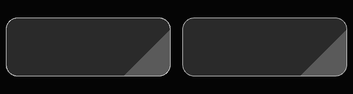

# UniXD

**在 Unity 中直接读取 Adobe XD，生成可继续编辑的 uGUI Prefab、图片、SVG 和导出元数据。**

UniXD 基于 kyubuns 的 [AkyuiUnity](https://github.com/kyubuns/AkyuiUnity) 与 [Auto9Slicer](https://github.com/kyubuns/Auto9Slicer) 持续开发，将原来的三个 UPM 包整合为一个包。它保留“XD → 中间布局 → Unity Prefab”的可扩展流水线，并增加画板选择、图层配置、稳定重导出、共享资源、软阴影和矢量渲染等能力。

- UPM 包名：`com.biengine.unixd`
- 自有代码命名空间：`BIEngine.UniXD` 及其子命名空间
- 一个包安装，运行时、布局加载、编辑器、XD 和九宫格分别编译为 DLL
- 编辑器导出工具；不需要在导入时启动 Adobe XD
- 面向 Unity uGUI，当前不生成 UI Toolkit UXML/USS

## 环境与安装

当前实际验证环境是 **Unity 6000.3.27f1、Windows、uGUI 2.0.0**。

包声明的最低 Unity 版本为 `6000.3`，自动安装以下依赖：

| 依赖 | 版本 | 用途 |
| --- | --- | --- |
| `com.unity.ugui` | `2.0.0` | uGUI 和 Unity 6 的 TextMeshPro |
| `com.unity.vectorgraphics` | `3.0.0-preview.7` | SVG 导入、几何 Sprite、SVGImage |

在 Package Manager 中选择 **Install package from git URL**：

```text
https://github.com/Binaryinject/UniXD.git
```

仓库根目录就是 UPM 包，无需追加 `?path=`。正式项目可以在 URL 末尾追加已发布 tag 或提交 SHA，固定版本。

本地开发也可以通过 **Install package from disk** 选择本仓库的 `package.json`。已安装原版时，先移除旧的三个包，避免同一脚本 GUID 被重复导入。

本仓库不包含商业项目的 XD 文件、字体、业务面板、OSA 或其他付费插件。使用 TMP 前，请在项目中导入 TMP Essential Resources，并准备设计稿使用的字体及对应 TMP Font Asset。

## 与原版相比增加了什么

原版本身已经提供 XD 解析、Prefab 生成、增量导入、可扩展 Trigger、TMP 插件、图集和自动九宫格。UniXD 的重点是把这条流水线扩展为可以逐层审核、反复重导出和管理共享资源的工作流。

| 方向 | 原版基础 | UniXD 的新增或扩展 |
| --- | --- | --- |
| 安装结构 | 核心、XD、九宫格分包 | 单个 UPM 包，保留 DLL 分层，统一命名空间 |
| 导入界面 | XD 拖入与导入设置 | 分区 Inspector、文件选择、最近文件、多文件选择、状态反馈、取消 |
| 画板管理 | 导入 XD 画板 | 搜索、仅看已选、批量勾选、Shift 范围选择、导出名覆盖及校验 |
| 图层审核 | 解析器与设计稿命名 | 合图窗口、原始路径、最终名称与组件预览、逐层覆盖名 |
| 合图与排除 | 自动解析分组 | 手动合图、自动矢量组规则、子树不导出、折叠与配置持久化 |
| 组件规则 | 固定命名约定和扩展脚本 | 可配置 Button/Toggle/InputField 规则，支持原名或导出名匹配 |
| 图片与矢量 | 位图资源输出 | 每层选择 PNG/Image 或 SVG/SVGImage，保留纯矢量组与子层选择 |
| 软阴影 | 未完整覆盖 XD dropShadows | 读取 XD 软阴影，独立留边图层、正确前后顺序、不扩大按钮点击区域 |
| 透明混合 | 使用 Unity 常规混合 | Linear 下可选匹配 XD，覆盖图片、顶点透明度、CanvasGroup、SVG、TMP |
| SVG 渐变 | 以位图为主 | 自动启用 Canvas UV2，保留透明与渐变；修正矩形斜向渐变坐标和端点精度 |
| 字体 | TMP 扩展 | 按 XD PostScript 名映射明确的 TMP 字体，并用于文本尺寸计算 |
| 重复导出 | 基本差异导入 | 内容指纹、持久缓存、资源完整性检查、Prefab 对象映射与 PNG/SVG 切换 |
| 共享资源 | 图片去重 Trigger | 跨画板共享图片库与索引、共享材质、引用迁移与短材质名 |
| 图集 | 创建 SpriteAtlas | 面积阈值筛选、超限图片独立压缩、SVG 排除、按内容避免重复写入 |
| 自动化 | 自定义导出脚本 | JSON 导出配置、源 XD 摘要核对、稳定 ID 审核计划与配置快照 |
| 大列表 | 常规编辑器控件 | 图层解析及预览缓存、严格搜索、按视口绘制可见行 |

按 2026-11-05 获取的上游源码对比，排除内置 Utf8Json 和独立测试后，三个模块从 **61 个 C# 文件扩展到 79 个**，新增 **18 个 C# 文件**，另有 **40 个原有 C# 文件发生变化**；源码由 7,844 行增加到 13,138 行，净增约 5,294 行。这是源码规模统计，包含命名、兼容和整理，不等同于独立功能数量。

对照基线及统计口径见 [原版差异说明](Documentation~/UpstreamComparison.md)。

## 第一次使用

### 1. 创建导出设置

通过 **Assets → Create → UniXD → XD → XdImportSettings** 创建设置资产。

主要路径都可以包含 `{name}`，导出时会替换为画板的最终导出名：

| 设置 | 示例 |
| --- | --- |
| Prefab Output Path | `Assets/UI/Prefabs/{name}` |
| Asset Output Directory Path | `Assets/UI/Resources/{name}/` |
| Meta Output Path | `Assets/UI/Meta/{name}Meta` |
| Font Directory Path | `Assets/Fonts/` |

Meta 是用于重导出映射的资源，请和生成的 Prefab 一起保留，不要只复制图片后丢弃 Meta。

### 2. 配置需要的扩展

扩展均为 ScriptableObject 资产，可通过 **Assets → Create → UniXD** 创建，再加入设置对应列表。基础解析器内置；以下是常见的增强组合，并非所有项目都必须启用全部项。

| 设置列表 | 常用资产 | 用途 |
| --- | --- | --- |
| Object Parsers | `TextMeshProXdParser` | XD 文本解析与 TMP 字体映射 |
| Group Parsers | `ConfiguredFlattenGroupParser` | 使用合图窗口保存的手动合图决定 |
| Group Parsers | `AutoFlattenVectorGroupParser` | 自动合并符合条件的装饰性矢量组 |
| XD Triggers | `NormalizeLayerNamesTrigger` | 导出命名整理与覆盖 |
| XD Triggers | `AutoComponentRulesTrigger` | 按可配置名称规则生成交互组件 |
| Triggers | `SetupTextMeshProTrigger` | 实际创建 TMP 文本和输入框组件 |
| Triggers | `SetupAuto9SlicerTrigger` | 位图自动九宫格 |
| Triggers | `SameSpriteDetectTrigger` | 相同 Sprite 检测 |
| Triggers | `SharedSpriteResourceTrigger` | 跨画板共享图片和共享资源策略 |
| Triggers | `CreateSpriteAtlasV2Trigger` | 为符合条件的位图创建图集 |

`TextMeshProXdParser` 和 `SetupTextMeshProTrigger` 分别负责解析、尺寸计算与 Unity 组件生成，使用 TMP 时要同时配置。Trigger 有执行顺序；自定义处理像素、切图或资源共享策略时，应保留明确顺序，并用二次导出验证结果。

Texture Preset 用于项目自己的纹理导入、压缩和平台设置。SVG 使用独立 SVGImporter，不作为普通 PNG 加入位图图集。

### 3. 选择 XD 和画板

在设置 Inspector 中点击“选择 XD 文件…”或拖入 `.xd` 文件。导出前进入画板列表：

- 搜索原画板名或导出名。
- 为画板填写唯一导出名；展开画板可以使用前缀。
- 全选、反选、只选 XD 已标记项或清空当前筛选结果。
- 先点击一项，再按住 Shift 点击另一项，批量勾选或取消范围。
- 点击行或复选框均可操作；搜索隐藏的项不参与范围选择。
- 进入每个画板的“合图设置…”检查图层。

### 4. 审核图层并导出

合图窗口会显示原名、原始路径、最终导出名、组件预览和合图覆盖关系。保存设置后回到画板列表，点击“导出所选”。

建议先导出一个小画板，检查字体、交互节点、阴影和缩放，再批量处理。修改 XD 后可以重新执行相同流程；没有变化的资源会尽量复用。

## 图层、合图与组件

### 图元和布局

内置解析链处理矩形与圆角、圆和椭圆、直线、路径、多边形及复合路径，也支持位图资源、分组、符号引用和解析后的组件状态。填充包含纯色、线性渐变和径向渐变；SVG 构建处理描边、裁剪及变换。具体复杂效果仍需代表画板验证。

生成结构保留解析后的尺寸、坐标、旋转和层级，可以生成 Image、文本、按钮、Toggle、输入框、Mask、滚动条及水平/垂直布局。配合 TMP 扩展替换文本和输入框。XD 重复网格可以作为列表/网格模板来源，但动态数据、运行时回收和设计原型中的业务跳转需要项目代码实现。

### 合图和不导出

合图适合无需独立变化的装饰组。动态文字、按钮、输入框、列表模板等应保留可操作的节点。

手动合图选中父组后，子项会显示为被父组合图覆盖；“不导出”会跳过节点及其子树。合图、排除、名称覆盖、滚动模式及矢量选择保存为画板配置，不修改 XD 文件。

搜索只匹配本行原名、覆盖名和最终导出名，不会因为父级匹配就把全部兄弟节点带入结果。搜索时保留原始路径，清除搜索后恢复折叠状态。Shift 范围勾选会跳过隐藏、不可操作和已被父组合图覆盖的项；勾选框及图层标题均可作为点击入口。

### 命名与交互组件

`AutoComponentRulesTrigger` 支持前缀、后缀、完全匹配和包含匹配；可以选择匹配原始名、导出名或两者，并控制大小写。

默认规则包括：

| 名称约定 | 组件 |
| --- | --- |
| `Btn_` 前缀 | Button |
| `button` 后缀 | Button |
| `toggle` 后缀 | Toggle |
| `inputfield` 后缀 | InputField；配合 TMP Trigger 生成 TMP_InputField |

组件规则采用首个匹配的交互规则，并避免在同一对象上重复创建互斥的 Selectable。已有显式解析器输出优先。

### 滚动视图

可为符合条件的滚动组选择“不生成 ScrollView”“普通 ScrollView”或“OSA ScrollView”。普通模式生成 uGUI ScrollRect 结构；OSA 选择会记录供扩展读取的意图，具体虚拟列表适配应由项目的生成 Trigger 完成。**本包不包含 OSA，也不会自动安装或实现业务列表适配器。**

## PNG、SVG 与九宫格

默认输出 PNG 和 Image。纯矢量层、纯矢量组可以改为“保持矢量”，输出 SVG 并通过官方 SVGImporter 生成几何 Sprite，使用 SVGImage 渲染。

- 纯矢量合图中有子层要求保留矢量时，合图可以整体输出 SVG。
- 混合位图组不能吞掉显式保留矢量的子层。
- 含文本或位图的混合组不能直接作为纯矢量整体导出。
- 只有点击范围、没有绘制内容的占位框保持透明，不导入空 SVG。
- PNG ↔ SVG 切换会替换冲突的 Graphic，重新映射按钮 targetGraphic，保留已有对象映射。
- SVG 渐变使用的 Canvas TexCoord2 通道由 `VectorCanvasChannels` 自动补齐；运行时重新挂到其他 Canvas 也会处理。

`SetupAuto9SlicerTrigger` 处理位图的可压缩区域，记录 Sprite Border。它不会把软阴影的透明留边当成按钮布局尺寸，也不会给独立阴影设置九宫格；SVG 不走 PNG 九宫格和位图图集处理。

独立调用九宫格 API：

```csharp
using BIEngine.UniXD.Slicing;

var result = Slicer.Slice(texture, SliceOptions.Default);
textureImporter.spriteBorder = result.Border.ToVector4();
System.IO.File.WriteAllBytes(outputPath, result.Texture.EncodeToPNG());
```

该 API 运行在 Editor；写回图片后请按项目的资源流程重新导入。

九宫格会缩小纹理文件，再由 Image/Sliced 按 Border 还原；不能仅根据看图软件中的压缩 PNG 判断实际构图。照片、插画和缓慢变化的渐变建议使用 **Tolerate = 0**（默认值），需要强制保留源图时，在 **XD 源位图图层名**后添加 `@NoSlice`。非零容差允许近似，不保证逐像素无损；当前算法按整段颜色范围约束容差，避免相邻色差累积导致误切。

导出 Trigger 使用 `Slicer.TrySlice(texture, options, out sliced)`。不需要切片时返回 false，不创建输出纹理，保留输入 PNG/JPEG 原始字节并跳过重编码；`Slicer.Slice` 的旧有返回完整纹理行为仍然保留。

## 切片性能与可选 Burst / Jobs

安装并启用 **Burst 1.8+** 后，包内的可选 `BIEngine.UniXD.Slicing.Burst.Editor` 自动启用。当前验证版本为 **1.8.31**。它不增加 UniXD 的必需依赖，也不需要 ECS。

- 仅对至少 **1024 × 1024 像素总量**、容差 0、可读的 RGB24/RGBA32/ARGB32/BGRA32 输入启用 Jobs。
- 并行检查重复行列、并行拷贝输出行；直接读取纹理的原生像素缓冲，避免两份整图托管数组。
- 小图、非零容差、其他像素格式、未安装或关闭 Burst 时，使用 C# 后备。
- C# 路径也有精确比较早停和连续内存行拷贝优化；PNG 尺寸直接读取 IHDR，其他格式保留解码后备。
- 不切片的原图跳过 PNG/JPEG 重编码，缓存策略版本更新后不会继续复用旧的误切结果。

本机 Unity Editor 热态实测：2560² 插画完整切片计算由旧实现约 409ms 降至 C# 约 68ms、Burst 约 31ms；使用 TrySlice 判定无需切片约 5ms。不同硬件、缓存和图片内容会影响结果，首次 Burst 编译另有成本，以上不是整个导出过程的加速比例。测试口径及编码耗时见 [性能与正确性说明](Documentation~/SlicingPerformance.md)。

## 软阴影、渐变与透明混合

### XD 软阴影

读取 XD `style.filters[].params.dropShadows`，按源 alpha 生成高斯软阴影，并保留阴影颜色、偏移、透明度和旋转。

阴影使用独立 `__XDShadow_*` 装饰节点，排在对应前景之前，带模糊扩展和透明留边。它不接收射线、不使用九宫格、不扩大按钮 RectTransform 和点击范围。即使装饰组被合图，阴影也会在源子节点消失前单独提取。

### Linear 下匹配 XD

设置里的“透明混合匹配 XD”在 Linear 项目中启用最终片元混合补偿，覆盖纹理透明度、Graphic 颜色 alpha、CanvasGroup、SVG、渐变、TMP 和裁剪后的透明度；Gamma 项目保持常规混合。

补偿不会预先破坏源图片的 alpha，也不把补偿烘焙进软阴影，避免叠加两次。普通 Image 使用包内 Shader；字体和 SVG 的兼容 Shader 根据源 Shader 生成到设置资产附近的 `GeneratedShaders`，不改写源字体 Shader。支持的 Shader 形式受生成器限制，不能保证任意自定义、多 Pass Shader 都能自动转换。

**补偿基于“补偿基准底色”（默认白色）。这是已知底色下的外观匹配，不能保证任意动态背景上的每个像素都与 XD 相同。** 对背景敏感的界面应按实际底色检查并配置，或关闭补偿。

非正方形矩形的斜向线性渐变使用本地像素坐标，避免归一化坐标在 SVG 中被宽高比拉歪。端点保留浮点精度，已有 gradientTransform 也会输出。

下面是实际 Unity 渲染对比：左侧 SVG，右侧为独立栅格参考；没有 UV2 时左侧会变为实心块。



## 共享资源、材质和图集

`SharedSpriteResourceTrigger` 提供跨画板资源共享。可指定主要资源库画板，默认名称为 `Resource`；共享目录可单独配置，留空时使用输出模板中 `{name} = Shared` 的目录。共享索引记录内容指纹和资源绑定，迁移时处理引用。

透明匹配生成的相同材质统一放在 `Shared/Materials`。判重保留着色器、材质参数、纹理和字体图集的差异；Sprite、UV 和 Graphic 顶点色不同不需要复制材质。

生成文件采用短名，例如 `XD_UI.mat`、`XD_Vector.mat`、`XD_VectorGradient.mat`、`XD_TMP_字体名.mat`。确实不同的材质使用短序号区分，不把 GUID 或散列拼进文件名。

图集 Trigger 支持单张图片最大面积阈值；超限图片保留独立纹理并使用单独压缩策略。默认阈值约为 2048 × 2048 的三分之一，可设置为 0 取消面积限制。SVG 不参与位图图集。图片、图集和共享资源政策的配置变化会参与缓存失效判断。

## 重复导出与自动化

### 稳定重导出

保留生成的 Prefab、Meta 及 `.meta` 文件。导入器通过源指纹、处理指纹和资源存在性检查复用缓存，映射已有对象；无变化的资源避免重复写入。不要把“无变化重导出稳定”理解为可以随意删除映射数据或保证任何自定义 Trigger 都没有副作用。

修改命名、合图、渲染模式或 Trigger 后，建议连续导出两次，检查第二次是否还产生非预期变化。可通过设置中的强制重导开关排查缓存问题。

### JSON 配置

画板窗口提供“保存自动化配置…”和“读取自动化配置…”，用于迁移画板选择、导出名及图层决定，包括合图、排除、矢量和滚动设置。

程序化入口：

```csharp
using BIEngine.UniXD.Xd;

var options = XdImporter.GetImportOptions(xdPath);
// selectedManifestPaths 使用上一步返回的 ManifestPath，不使用数组下标定位画板。
XdImporter.Import(settings, xdPath, selectedManifestPaths);
```

`XdAutomationRecipe.ExportReviewed` 支持源 XD SHA-256 校验、已审核的画板及图层稳定 ID、配置快照和正常导出链路。源文件摘要或目标 ID 不匹配时会拒绝套用旧计划；它不是按截图猜测或自动生成业务代码的接口。

## 扩展接口

接口和类型按职责命名，去掉品牌前缀，由 `BIEngine.UniXD` 命名空间区分归属。例如使用 `ILoader`、`ImportTrigger`、`ImportSettings`、`XdLoader` 和 `PrefabMeta`，不再额外添加 Akyui 或 Uni 前缀。

| 接口或基类 | 用途 |
| --- | --- |
| `ILoader` | 提供中间布局和资源 |
| `ImportTrigger` | 资源预处理、组件生成、Prefab 后处理和完成回调 |
| `XdObjectParser` | 扩展单节点识别、尺寸和组件解析 |
| `XdGroupParser` | 扩展组解析及合图策略 |
| `XdImportTrigger` | XD 命名、组件规则及解析参与控制 |
| `IPrefabAppearanceSettings` | 最终 Prefab 外观处理及配置指纹 |
| `IVectorAssetLoader` | 加载矢量材质 |

另外保留以下可选工具：`XdCommentOutTrigger` 可按前缀跳过图层（默认 `#`）；`DisableLayouterTrigger` 在导出后关闭 LayoutGroup；`GitKeepTrigger` 为输出目录建立 `.gitkeep`。`SetupAnKuchenTrigger` 为上游 AnKuchen 集成，只有安装相应插件时通过条件编译启用，不是 UniXD 的必需依赖。

包不依赖 BIEngine 的 Logging、UIPanelStack 或 VContainer 扩展。这些属于项目集成，独立安装 UniXD 不需要同时安装它们。

## DLL 与目录结构

| DLL | 目录 | 平台 |
| --- | --- | --- |
| `BIEngine.UniXD` | `Core/Runtime` | Editor / Player |
| `BIEngine.UniXD.Loader` | `Core/Loader` | Editor |
| `BIEngine.UniXD.Editor` | `Core/Editor` | Editor |
| `BIEngine.UniXD.Extensions` | `Core/Extensions` | Editor |
| `BIEngine.UniXD.Xd.Editor` | `Xd/Editor` | Editor |
| `BIEngine.UniXD.Xd.Extensions` | `Xd/Extensions` | Editor |
| `BIEngine.UniXD.Slicing.Editor` | `Slicing/Editor` | Editor |
| `BIEngine.UniXD.Slicing.Burst.Editor` | `Slicing/Burst` | Editor，可选，安装 Burst 后启用 |
| `Utf8Json` | `Core/Loader/Libraries/Utf8Json` | Editor，保留上游名称与命名空间 |

`Xd/Runtime/Shaders` 存放运行时使用的 Shader；编辑器导出代码不会因此进入 Player。运行时可能包含元数据组件和 SVG Canvas 通道辅助组件，因此不宣称导出产物“完全没有运行时组件”。

## 从旧包迁移

1. 备份工程并提交或保存当前可用状态。
2. 移除 `dev.kyubuns.akyuiunity`、`dev.kyubuns.akyuiunityxd`、`dev.kyubuns.auto9slicer`，安装 `com.biengine.unixd`。不要同时保留两套相同脚本。
3. 更新自定义源码、asmdef、link.xml 和反射中的程序集及命名空间。保留原脚本/asmdef GUID 不能替代更新程序集限定的类型字符串。
4. 将旧 `AkyuiUnity.*` 引用改为 `BIEngine.UniXD.*`；`XdParser.*` 改为 `BIEngine.UniXD.Xd.Parsing.*`；`Auto9Slicer` 改为 `BIEngine.UniXD.Slicing`。
   常见类型对应关系：`IAkyuiLoader` → `ILoader`，`AkyuiImportTrigger` → `ImportTrigger`，`AkyuiImportSettings` → `ImportSettings`，`AkyuiLoader` → `LayoutLoader`，`XdAkyuiLoader` → `XdLoader`，`AkyuiGenerator` → `PrefabGenerator`，`AkyuiMeta` → `PrefabMeta`。
5. 更新自定义 Shader 中的包路径；内置混合 Shader 位于 `Packages/com.biengine.unixd/Xd/Runtime/Shaders`。
6. 检查设置资产、Prefab 缺失脚本、TMP 字体、材质和两次导出结果。

迁移版本保留原脚本及 asmdef 的 `.meta` GUID，保留旧画板配置使用的 EditorPrefs 键以及 `.aky` 中间格式。旧序列化字段通过必要的迁移标记读取，不提供一套带旧品牌前缀的公开 API 别名。程序集改名属于 Player 代码变化，使用 IL2CPP、HybridCLR 或裁剪的项目需重新生成和验证相应主包产物。

## 验证范围与边界

已在 Unity 6.3 环境验证真实 XD 按钮阴影、PNG/SVG 切换、对象引用、重复导出、Linear/Gamma 混合、TMP、裁剪、共享材质、Shift 原生点击及大列表窗口。迁移验证记录见 [验证说明](Documentation~/Validation.md)。

可复用的切片回归位于 `Tests~/Editor`。将该目录复制到测试工程 `Assets/UniXDTests`，安装 Unity Test Framework 后，在 EditMode 运行 `BIEngine.UniXD.Tests.SlicingTests`；无需商业 XD 或字体夹具。未安装 Burst 时，专门比较 Burst 的用例会跳过。

这不是所有 XD 效果、所有 Unity 版本和所有自定义 Shader 的全面兼容承诺。复杂设计稿应先选择代表画板核对；字体替换、动态背景、透明组叠加和项目自定义 Trigger 尤其需要检查。导出器生成资源和组件结构，不生成网络、业务逻辑或虚拟列表的数据绑定。

## 许可证与致谢

UniXD 使用 MIT 许可证，见 [LICENSE](LICENSE)。

感谢 [kyubuns](https://github.com/kyubuns) 的 AkyuiUnity、Akyui 和 Auto9Slicer。原始许可证保留在各模块内；内置 Utf8Json 保留其许可证、名称和来源。详见 [第三方声明](THIRD-PARTY-NOTICES.md)。
